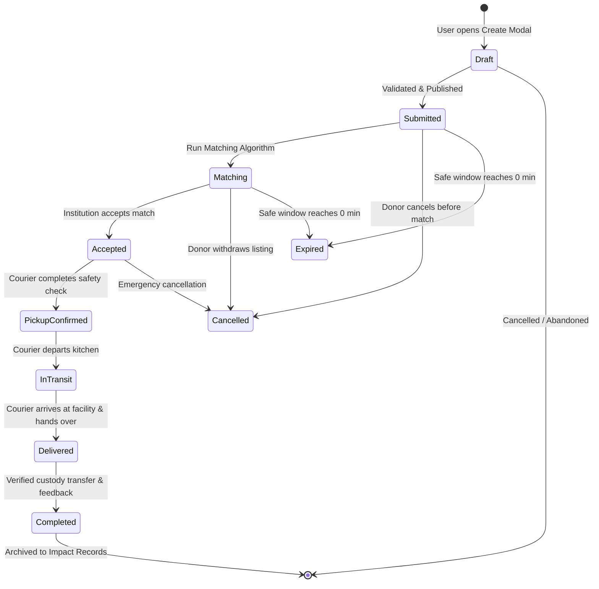

# ServeLink Donation State Transition Network (STN)

This document formalizes the 10-state lifecycle of a ServeLink donation.

---

## 1. State Transition Diagram

---

## 2. State Definitions & Visual Indicators

| State | Semantic Meaning | Icon & Badge Visual Treatment | Permitted User Actions |
| :--- | :--- | :--- | :--- |
| **`Draft`** | Modal is open; donor is configuring parameters | Gray subtle outline | `Publish`, `Cancel` |
| **`Submitted`** | Logged to local database; waiting for recipient matching | Blue/Forest tint + `Send` icon | `View Recommended Recipients`, `Cancel` |
| **`Matching`** | Deterministic engine calculated candidate scores | Sage light tint + `Sparkles` icon | `Select Recipient`, `View All Matches` |
| **`Accepted`** | Recipient institution confirmed acceptance | Green badge + `Check` icon | `Track Active Dispatch`, `Prepare Cargo` |
| **`Pickup Confirmed`**| Volunteer signed off 4-item safety checklist | Cream surface + `PackageCheck` icon | `Depart on Route` |
| **`In Transit`** | Consignment in thermal container en route | Neutral slate + `Truck` icon | `Mark Arriving Soon` |
| **`Delivered`** | Physical custody transferred to caregiver | Success green + `CheckCircle2` icon | `Confirm Signoff` |
| **`Completed`** | Handover logged; impact metrics incremented | Gold/Green + `Trophy` icon | `View Impact Summary`, `Review Next` |
| **`Expired`** | 90-minute safe freshness cutoff elapsed | Muted red + `XCircle` icon | None (Claim action permanently disabled) |
| **`Cancelled`** | Order terminated by kitchen or logistics | Muted red + `Ban` icon | `Archive` |

---

## 3. Invariants & Safety Enforcements
1. **Freshness Invariant:** If `minutesRemaining <= 0`, state unconditionally transitions to `Expired`. Acceptance buttons are immediately replaced with disabled states to prevent foodborne illness risks.
2. **Safety Checkpoint Invariant:** Transition from `Accepted` to `Pickup Confirmed` requires all four safety checkboxes (`Packaging intact`, `Food labelled`, `Prepared time verified`, `Recipient details confirmed`) to evaluate to `true`.
